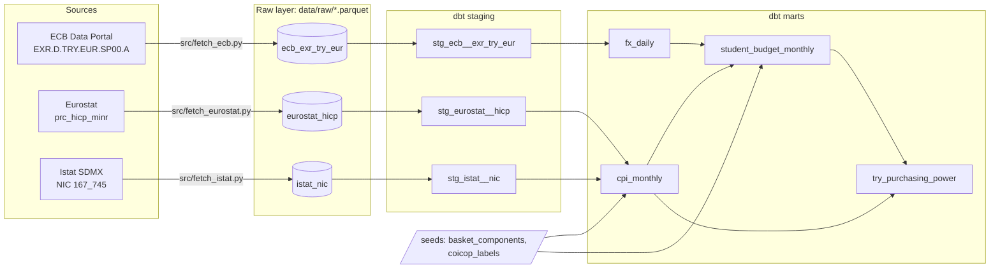

# Student Cost of Living: Italy in EUR and TRY

[](https://github.com/hakan-ay/student-cost-of-living/actions/workflows/ci.yml)
[](https://github.com/hakan-ay/student-cost-of-living/actions/workflows/refresh.yml)

**How much does a month as a Turkish student in Italy cost in EUR and in TRY, and how fast is it changing?**

An automated data pipeline on official open data: Python fetchers pull exchange rates and consumer prices from
the ECB, Eurostat and Istat into Parquet snapshots, and a **dbt** project on **DuckDB** turns them into tested
marts. A GitHub Actions job refreshes everything every week and commits the new data. Later milestones add an
LLM-written weekly brief with numeric guardrails and a dashboard (see [Roadmap](#roadmap)).

> **Status:** milestones W1-W3 (sources, raw layer, dbt models and tests, weekly automation). No API keys are needed.

## Latest numbers

<!-- latest-numbers:start -->
Generated from the marts: consumer prices up to September 2026, exchange rate up to 21 October 2026.

| | Sep 2025 | Sep 2026 | Change |
|---|---:|---:|---:|
| Monthly budget in EUR | 830 | 854 | +2.9 % |
| Average EUR/TRY | 48.5 | 56.0 | +15.5 % |
| Monthly budget in TRY | 40,237 | 47,834 | +18.9 % |
| Budget in TRY at 2025 Turkish prices | 38,035 | 34,854 | −8.4 % |

In nominal lira the budget changed by +18.9 % in a year. Turkish prices rose faster than the euro did (Turkish HICP +29.7 % against EUR/TRY +15.5 %), so for a household whose income keeps up with Turkish inflation the same month in Italy became about 8 % cheaper in real terms.
<!-- latest-numbers:end -->

## Sources

| Source | Series | Frequency | Used for |
|---|---|---|---|
| [ECB Data Portal](https://data.ecb.europa.eu/) | `EXR.D.TRY.EUR.SP00.A`, euro reference rate for the Turkish lira | Daily, from 2005 | `fx_daily`, EUR to TRY conversion |
| [Eurostat](https://ec.europa.eu/eurostat/databrowser/view/prc_hicp_minr/default/table) | `prc_hicp_minr`, HICP (ECOICOP ver. 2), Italy and Turkey, index 2025=100 and annual rate | Monthly, from 2005 | `cpi_monthly`, basket indexation, inflation gap |
| [Istat](https://esploradati.istat.it/) | NIC dataflow `167_745`, Italian national CPI detail, base 2025=100 | Monthly, from 2026 | `cpi_monthly` detail (tenants' rents, bus and coach), cross-check of rents |

**Note on Eurostat datasets.** The original plan used `prc_hicp_manr` (annual rates) and `prc_hicp_midx` (indices).
With the January 2026 release Eurostat moved the HICP to ECOICOP ver. 2 and froze those datasets at December
2025. `prc_hicp_minr` carries the full history on the new classification and holds both indices and rates, so it
replaces both. Category codes follow ECOICOP ver. 2 (for example `CP041` actual rentals, `CP0732` passenger
transport by road).

## Reference basket

The budget is a fixed basket for a Turkish student living in a shared flat in Turin, priced at **2025 average
prices**. Each component is moved over time with the Italian HICP index of its category (2025 = 100), so the
2025 average of the budget equals the base total.

| Component | Base (EUR / month, 2025) | Weight | Indexed with |
|---|---:|---:|---|
| Rent (single room, shared flat, utilities included) | 450 | 54.5 % | HICP `CP041` actual rentals for housing |
| Food (groceries, occasional canteen meal; midpoint of 250-300) | 275 | 33.3 % | HICP `CP01` food and non-alcoholic beverages |
| Transport (free for students under 26 with the Piemove regional pass) | 0 | 0.0 % | HICP `CP0732` passenger transport by road |
| Other (phone, personal care, clothing, study material, leisure) | 100 | 12.1 % | HICP all items |
| **Total** | **825** | **100 %** | |

The base amounts are the author's assumptions from student consulting work, not an official statistic. They live
in [`dbt/seeds/basket_components.csv`](dbt/seeds/basket_components.csv) and can be changed without touching SQL.
Transport is kept as a zero-amount component so that a student aged 26 or over only needs a new base amount
(for example a monthly pass) instead of a model change.

## Data model



| Mart | Grain | What it answers |
|---|---|---|
| `fx_daily` | ECB business day | EUR/TRY, euros per 1,000 lira, change over 1, 30 and 365 days |
| `cpi_monthly` | source × country × category × month | Price indices (2025=100) and monthly / annual rates for Italy and Turkey |
| `student_budget_monthly` | month | The basket in EUR by component, converted to TRY at the month's average rate, with year-on-year changes |
| `try_purchasing_power` | month | Inflation-adjusted EUR/TRY (2025=100) and the budget in constant 2025 lira |

**Definitions.**
- `real_eur_try_index_2025` = (EUR/TRY ÷ 2025 average) × (Italian HICP ÷ Turkish HICP) × 100. Above 100 means
  the lira lost more value against the euro than Turkish prices rose since 2025, so Italy became more expensive
  for lira earners.
- `budget_try_at_2025_prices` = budget in TRY ÷ (Turkish HICP / 100), the budget in 2025 lira.

## Data tests

`dbt build` runs 59 tests on every model and seed:

- **Keys and grain:** `not_null` / `unique` on dates, and a custom `unique_combination_of_columns` test on the
  long CPI tables.
- **Accepted ranges:** a custom `accepted_range` test (EUR/TRY between 1 and 500, daily moves within ±30 %,
  annual inflation between −50 % and 200 %, budget between 300 and 3,000 EUR, ...).
- **Referential integrity:** every category in `cpi_monthly` and in the basket has a label.
- **Business rules:** the EUR total equals the sum of its components; the 2025 average of the budget equals the
  base total (checks the 2025=100 indexation).
- **Cross-source check (warn):** Istat NIC and Eurostat HICP annual rates for Italian rents differ by at most
  0.5 percentage points.
- **Source freshness:** `dbt source freshness` warns when a raw file was not refreshed for 8 days.

## How to run

Requires [uv](https://docs.astral.sh/uv/) (Python 3.12 is installed automatically).

```bash
uv sync
uv run python src/fetch_all.py        # incremental fetch of all three sources into data/raw/
cd dbt
uv run dbt build                      # seeds, models and tests into data/warehouse.duckdb
uv run dbt source freshness
uv run dbt docs generate && uv run dbt docs serve   # optional: lineage graph and column docs
cd ..
uv run python src/export_marts.py     # marts to data/marts/*.parquet
uv run python src/update_readme.py    # rewrite the "Latest numbers" block from the marts
```

Run dbt from the `dbt/` folder: the profile and the raw Parquet paths are relative to it.

**Incremental fetch.** The first run downloads the full history. Later runs only request a recent window and
upsert it on the series key: the last 7 days for the ECB rate, the last 13 months for Eurostat and Istat
(statistical offices revise recent months). `--full` re-downloads everything.

The raw Parquet files are public statistics and are committed, so `dbt build` works on a fresh clone without
network access. The DuckDB warehouse is rebuilt by dbt and is not committed; the marts are exported to
`data/marts/` instead.

## Automation

| Workflow | Trigger | What it does |
|---|---|---|
| [`ci.yml`](.github/workflows/ci.yml) | every push and pull request | `dbt build` on the committed raw data, then checks that the README numbers match the marts |
| [`refresh.yml`](.github/workflows/refresh.yml) | Mondays 06:00 UTC, or manually | fetch all sources → `dbt build` → `dbt source freshness` → export marts → regenerate the README block → commit `data/` and `README.md` to `main` |

The refresh job is built to fail loudly but degrade gracefully: if one source cannot be reached, the other
sources are still refreshed and committed, and the job is marked as failed at the end. A failing data test stops
the job before anything is committed, so `main` only ever holds data that passed every test. The latest numbers
are also written to the run's summary page.

## Project layout

```
src/
  raw_store.py          HTTP with retries, Parquet upsert helper
  fetch_ecb.py          ECB daily EUR/TRY
  fetch_eurostat.py     Eurostat HICP (prc_hicp_minr), IT and TR
  fetch_istat.py        Istat NIC detail for Italy
  fetch_all.py          runs the three fetchers
  export_marts.py       marts to data/marts/*.parquet
  update_readme.py      "Latest numbers" block of this README, generated from the marts
data/raw/               Parquet snapshots (one file per source)
data/marts/             exported marts, refreshed weekly
.github/workflows/      CI and weekly refresh
dbt/
  models/staging/       one model per source, typed and pivoted
  models/marts/         fx_daily, cpi_monthly, student_budget_monthly, try_purchasing_power
  seeds/                reference basket and category labels
  tests/                custom generic tests and singular business-rule tests
```

## Roadmap

- [x] **W1-W2: sources and model.** Fetchers for ECB, Eurostat and Istat, Parquet raw layer, dbt staging and
  marts, 59 data tests.
- [x] **W3: scheduled pipeline.** Weekly GitHub Actions refresh that commits tested data back to `main`, CI on
  every push, README numbers generated from the marts (see [Automation](#automation)).
- [ ] **W4: LLM weekly brief.** TODO: a short weekly brief written with the Claude API from the mart tables
  (check the current model IDs and structured-output options before building). Guardrail: every number in the
  brief must exist in the input tables; the brief is returned as structured output with the numbers it cites,
  each one is checked against the marts, and a brief that fails the check is not published.
- [ ] **W5: dashboard.** TODO: Streamlit app on the marts: budget in EUR and TRY over time, component breakdown,
  real EUR/TRY index, and an editable basket.

## Limitations

- The basket amounts are assumptions for one city (Turin) and one lifestyle; the indices are national, so local
  rent dynamics in Turin can differ from the Italian average.
- HICP rents (`CP041`) follow existing tenancies, which move more slowly than asking rents for new contracts,
  which is what an arriving student faces.
- `try_purchasing_power` assumes the household's lira income grows with Turkish inflation; real wage changes are
  not modelled.
- Istat NIC detail on base 2025 starts in January 2026, so it is used for detail and cross-checks, not for history.
